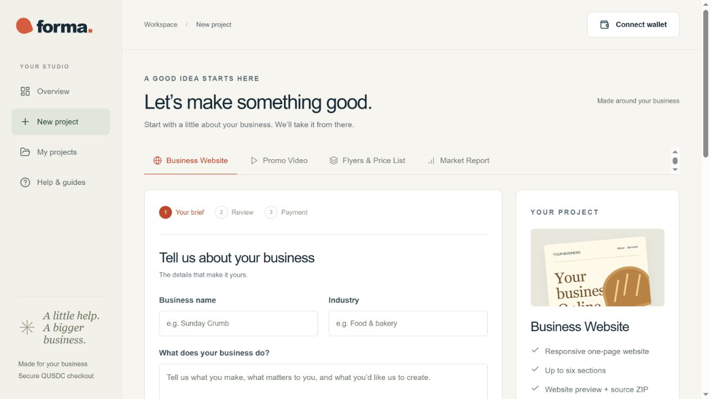
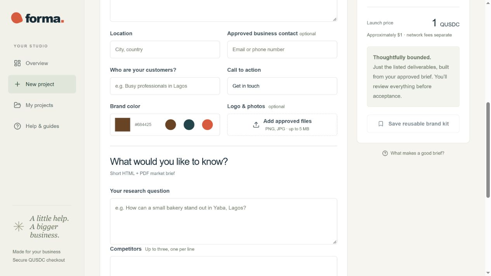
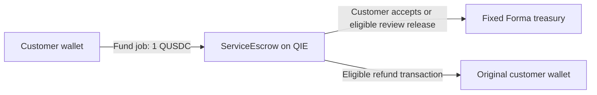
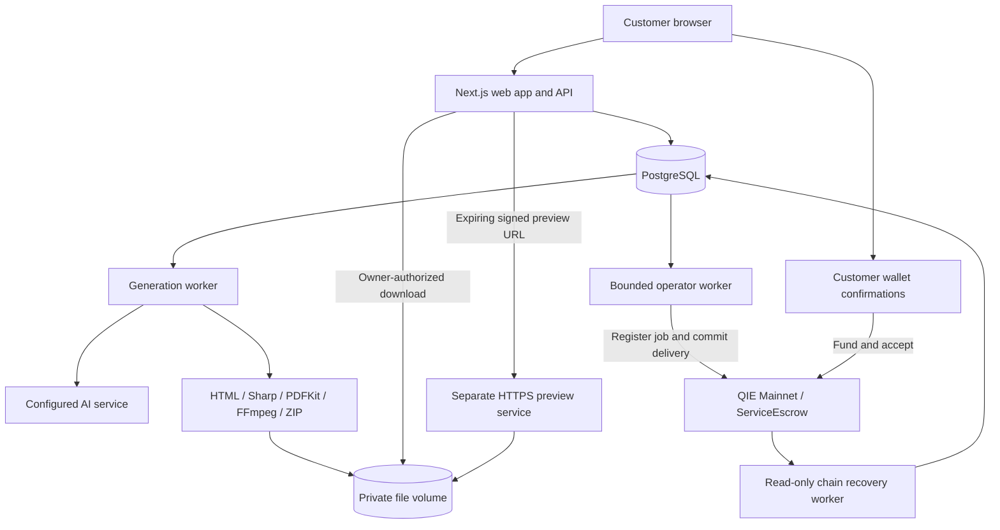

# Forma

**A little help. A bigger business.**

Forma gives small businesses one place to commission a website, promotional video, flyer and price list, or short market report. Customers bring their approved business details, fund a fixed-price job in QUSDC, and receive private files to review before accepting delivery. A QIE Mainnet escrow records funding, the delivery commitment, and settlement.

**Try it:** [useforma.site](https://useforma.site) · [Start a project](https://useforma.site/new) · [Help and payment terms](https://useforma.site/help) · [Verified escrow](https://mainnet.qie.digital/address/0xbf0bd3c5231872006ecbf3557e7aa730ec797032?tab=contract)

## At a glance

|              | Forma                                                                                                |
| ------------ | ---------------------------------------------------------------------------------------------------- |
| Built for    | Independent businesses that need practical creative assets                                           |
| Services     | Business websites, promotional videos, flyers and price lists, market reports                        |
| Launch price | **1 QUSDC per service**; QIE network fees are separate                                               |
| Network      | QIE Mainnet, chain ID `1990`                                                                         |
| Sign-in      | Wallet signature; private projects belong to the signing wallet                                      |
| Payment      | Customer funds the ServiceEscrow contract, rather than sending the service payment directly to Forma |
| Delivery     | Private downloads, technical checks, checksums, and a manifest commitment recorded on-chain          |
| Review       | Customer acceptance, problem reporting, and a 48-hour on-chain review window                         |
| Hosting      | Containerized VPS app, PostgreSQL, independent workers, and a separate HTTPS preview origin          |
| Live app     | [useforma.site](https://useforma.site)                                                               |

## Why Forma

A small business may need several different assets before it can start promoting an offer: a place to explain its services, a price list customers can read, a short video to share, and a clearer view of its market. Forma turns those needs into four bounded services with a shared brief, a visible price, downloadable deliverables, and a recorded review process.

The business owner supplies the facts. Forma uses AI-assisted content generation and controlled renderers to produce the listed files. Approved prices, contact details, and uploaded assets are treated as customer inputs, not opportunities to invent business claims. Customers still review the result before publishing or accepting it.

## Product tour

These screenshots show the actual public Forma interface. The forms are unfilled; no private customer project, wallet balance, or completed purchase is represented.

**Choose a service.** Explore the four services and their launch price from the homepage.


**Describe your business.** Start with the business name, services, location, audience, approved contact details, brand color, and optional photos or logo. Each service adds its own inputs and deliverable scope.



**Ask a focused research question.** The market-report brief supports a research question, up to three competitors, and up to five optional public reference URLs.



## What each service delivers

| Service                 | Customer provides                                                                                                      | Included files and scope                                                                         |
| ----------------------- | ---------------------------------------------------------------------------------------------------------------------- | ------------------------------------------------------------------------------------------------ |
| **Business Website**    | Business brief, call to action, brand color, up to six selected sections, optional approved images and reference style | Responsive one-page HTML website, private preview, and source ZIP                                |
| **Promo Video**         | Business brief, offer or main message, tone, brand color, and optional approved images                                 | One 12–16 second vertical MP4 at 1080 × 1920, poster PNG, and captions TXT                       |
| **Flyers & Price List** | Business brief, real offer, exact item prices and currencies, optional genuine expiry date                             | 1080 × 1350 promotional PNG, matching promotional PDF, and A4 price-list PDF with up to 20 items |
| **Market Report**       | Business brief, location, research question, optional competitors and reference URLs                                   | Short HTML and PDF market brief, up to five substantive sections, and source-table CSV           |

Each service currently costs **1 QUSDC**, approximately $1 at the intended dollar value of the token. Forma does not guarantee QUSDC's market value, backing, redemption, or bridge behavior.

The first release has a defined scope: no multi-page website, ecommerce backend, custom-domain purchase or hosting for generated customer websites, soundtrack, voiceover, stock-media purchase, square video export, or included revision cycle. The website service delivers source files; the private preview is not a permanent public hosting plan.

## How a project works

1. **Connect and sign in.** Connect an Ethereum-compatible browser wallet. Forma checks the QIE network and requests a domain-bound Sign-In with Ethereum message. Signing in is free and does not authorize a token transfer.
2. **Prepare the brief.** Choose a service, enter the real business details, and upload only approved assets. A reusable brand kit can save shared details for later projects. Browser drafts help retain unfinished input; wallet-owned records require sign-in.
3. **Review the scope and price.** Confirm the brief, listed deliverables, and payment terms. Forma creates a fixed quote and freezes the approved information for that order.
4. **Register and fund.** The bounded operator registers the job on-chain. The customer approves the exact QUSDC allowance when needed, then confirms funding in their own wallet. Registration must be confirmed before funding can proceed.
5. **Generate and check.** After canonical funding verification, the generation worker produces structured content. Controlled HTML, image, PDF, ZIP, and video renderers create the files and run technical checks.
6. **Record delivery.** The operator submits the delivery manifest hash to escrow. Once delivery is confirmed on-chain, the customer can review the private files and the 48-hour review window begins.
7. **Accept or report a problem.** Accepting in the customer's wallet releases escrowed QUSDC to Forma's fixed treasury. “Report a problem” saves a support issue for review; it is not an automatic refund or a pause to the on-chain deadline.

The app reconciles receipts and updates project state in the background. A transaction hash by itself is not proof of payment or settlement. Customers always confirm their own funding and acceptance transactions.

## Where the money goes



The QUSDC service payment remains in escrow until a permitted release or refund. Forma's database stores job records and receipt evidence; it does not hold the escrowed tokens. Wallet network fees are paid separately in QIE.

### Deadlines, acceptance, and refunds

| Situation                                      | Contract behavior                                                                                                                         |
| ---------------------------------------------- | ----------------------------------------------------------------------------------------------------------------------------------------- |
| Funding window                                 | The registered job must be funded before its expiry, at most 30 minutes after registration                                                |
| Delivery window                                | Delivery commitment is due within 24 hours of verified on-chain funding                                                                   |
| Customer acceptance                            | Only the recorded customer can accept a delivered job; funds go to the fixed treasury                                                     |
| Review window expires                          | After 48 hours from on-chain delivery, anyone may submit the review-release transaction; funds still go to the treasury, never the caller |
| Delivery is late and no delivery was submitted | The recorded customer may claim a late refund after the delivery deadline                                                                 |
| Operator-approved refund                       | The operator can refund a funded or delivered job before settlement; the recipient is the original customer                               |
| Customer reports a problem                     | A private support issue is recorded; the deadline and contract state do not change automatically                                          |

**Passing a deadline alone never sends tokens.** An eligible release or refund must still be submitted and confirmed on-chain. Accepting delivery settles the job; there is no unilateral customer refund after settlement. Support should be contacted before the review deadline when there is a problem.

The contract has a fixed asset, treasury, and operator. It has no upgrade function, arbitrary withdrawal destination, swap, bridge, or general token-recovery function. Read [ServiceEscrow.sol](contracts/ServiceEscrow.sol) for the exact rules.

## What is on-chain and what stays private

| On QIE Mainnet                                | In Forma's private application storage                                        |
| --------------------------------------------- | ----------------------------------------------------------------------------- |
| Job identifier and customer wallet            | Business brief and reusable brand kit                                         |
| Fixed QUSDC amount and asset                  | Uploaded logos and photos                                                     |
| Terms hash, deadlines, and escrow state       | Generated website, video, images, PDFs, and source files                      |
| Delivery manifest hash                        | Manifest contents, technical checks, and file metadata                        |
| Funding, delivery, release, and refund events | Project timeline, support issues, generation state, and spending reservations |

A hash is a commitment to a particular version, not a copy of the private files. It can help establish that delivered bytes match a manifest; it does not prove that the writing is accurate or commercially effective. Wallet addresses and on-chain job activity are public even when the business brief and downloads are private.

Downloads require an authenticated owning wallet. HTML previews use short-lived signed URLs on a separate origin, with sandboxed content and restricted resources. Treat a signed preview link as temporarily shareable with anyone who possesses that link; it is not a permanent public URL.

## Architecture

Forma separates the customer interface, paid content generation, signing authority, chain recovery, and generated-page previews.



| Process               | Responsibility                                                                             | Sensitive access                                                          |
| --------------------- | ------------------------------------------------------------------------------------------ | ------------------------------------------------------------------------- |
| Web/API               | Wallet authentication, briefs, quotes, orders, support, downloads, and admin authorization | Database and private files; no generation API key or operator signing key |
| Generation worker     | Content request, validation, durable stages, rendering, and artifact checks                | Generation API key, database, and private files; no mainnet signer        |
| Operator worker       | Approved registration and delivery transactions; durable transaction tracking              | Operator key and bounded policy; no generation API key                    |
| Chain recovery worker | Canonical receipt reconciliation and event recovery                                        | Read-only RPC access and database; no signing or generation key           |
| Preview service       | Serve permitted HTML previews with expiring signatures and restrictive headers             | Private artifact access; no generation or signing key                     |

### Recovery and spending controls

Jobs have durable stages and execution leases. Provider responses are saved before validation, allowing a restart to render an already-received valid response without paying for another request. Ambiguous provider outcomes require reconciliation rather than automatic rebilling.

Provider capacity is reserved before customer funding and reused during generation. Paid calls require explicit configuration, an approved aggregate budget, per-job limits, and conservative input/output/search estimates. These are application spending bounds, not a guarantee about the provider's eventual bill.

The operator has a separate policy with a unique approval ID, aggregate QIE allocation, per-transaction fee cap, expiry, and permitted actions. Registration reserves capacity for both registration and eventual delivery. The normal automation covers registration and delivery; it does not accept work on behalf of customers or grant an open-ended refund/transfer allowance.

Transaction identity is persisted before broadcast. Recovery checks an ambiguous transaction before further action, and does not sign a replacement blindly. Missing exact signed transactions may only be rebroadcast under the existing policy after their identity, nonce, calldata, chain, sender, and fee reservation are checked.

Stale worker heartbeats, unavailable dependencies, depleted capacity, and expired operator authorization prevent new sales. There is no public demo funding endpoint or substitute-content fallback when a real service is unavailable.

## QIE Mainnet contract

| Field                  | Value                                                                                                                                                                     |
| ---------------------- | ------------------------------------------------------------------------------------------------------------------------------------------------------------------------- |
| Network                | QIE Mainnet                                                                                                                                                               |
| Chain ID               | `1990` (`0x7c6`)                                                                                                                                                          |
| Native gas token       | QIE                                                                                                                                                                       |
| QUSDC                  | [`0x3F43DA82eC9A4f5285F10FaF1F26EcA7319E5DA5`](https://mainnet.qie.digital/address/0x3F43DA82eC9A4f5285F10FaF1F26EcA7319E5DA5)                                            |
| QUSDC decimals         | `6`                                                                                                                                                                       |
| Price in base units    | `1,000,000` per job                                                                                                                                                       |
| ServiceEscrow          | [`0xbf0bd3c5231872006ecbf3557e7aa730ec797032`](https://mainnet.qie.digital/address/0xbf0bd3c5231872006ecbf3557e7aa730ec797032?tab=contract)                               |
| Treasury / operator    | `0xC137afa61B212D1492ad70B34b614aD7Aab9A873`                                                                                                                              |
| Deployment transaction | [`0x5e69423462806fa2051372fdf188c87c8b85a656b7a8f6cf6145283a115a417e`](https://mainnet.qie.digital/tx/0x5e69423462806fa2051372fdf188c87c8b85a656b7a8f6cf6145283a115a417e) |

The escrow source is verified on the QIE explorer. Compiler/deployment details are in [contracts/DEPLOYMENT.md](contracts/DEPLOYMENT.md), and the public deployment record is [deploy/escrow-mainnet.json](deploy/escrow-mainnet.json). Source verification and bytecode matching are not an independent security audit.

Ordinary use of the app does not require deploying another contract. Never redeploy the production contract to recover an uncertain transaction; reconcile the existing receipt and deployment record first.

## Technology and repository layout

| Layer                        | Technology                                                                     |
| ---------------------------- | ------------------------------------------------------------------------------ |
| Interface and API            | Next.js 16, React 19, TypeScript, Lucide                                       |
| Wallet and chain interaction | viem, wallet-injected EIP-1193 provider, Sign-In with Ethereum                 |
| Database                     | PostgreSQL in public hosting; persistent SQLite for explicitly local operation |
| Validation                   | Zod schemas, approved-fact checks, bounded lists and text                      |
| Rendering                    | Controlled HTML/SVG, Sharp, PDFKit, Archiver, FFmpeg                           |
| Escrow                       | Solidity, OpenZeppelin SafeERC20 and ReentrancyGuard                           |
| Testing                      | Node test runner, tsx, isolated provider/RPC fixtures, local Ganache EVM       |
| Deployment                   | Node 24 container, Docker Compose, Caddy HTTPS, private volumes                |

```text
app/                    Pages and authenticated API routes
components/             Brief, project, checkout, wallet, and workspace UI
lib/                    Validation, orders, payments, provider budgets, and security
worker/                 Generation, operator, chain recovery, and preview services
contracts/              ServiceEscrow source and public deployment evidence
migrations/             Relational database schema
scripts/                Local supervisor, reconciliation, migration, and deployment tools
tests/                  Isolated workflow, wallet, recovery, and escrow tests
deploy/                 Production container, Compose file, and deployment runbook
docs/tour/              Screenshots of the actual public interface
build-pack/             Original build specification and visual references
```

## Run locally

### Prerequisites

Use **Node.js 24 or later** and npm. FFmpeg must be available for video rendering; the production image installs system FFmpeg and fonts, while local rendering can use the installed `ffmpeg-static` package or an explicit `FFMPEG_PATH`. Docker is needed for container/PostgreSQL deployment checks, not the SQLite unit/workflow suite.

```bash
git clone https://github.com/vickman787/forma.git
cd forma
npm ci
```

Copy `.env.example` to an ignored `.env` (`Copy-Item .env.example .env` in PowerShell, or `cp .env.example .env` in a POSIX shell). Configure the required values before starting the complete live-mode stack. The example deliberately leaves paid calls, operator transactions, and checkout disabled.

### Configuration groups

| Group                     | Important settings                                                                                                                                               |
| ------------------------- | ---------------------------------------------------------------------------------------------------------------------------------------------------------------- |
| Local origins and storage | `APP_MODE=live`, `LOCAL_ONLY=true`, `APP_URL=http://127.0.0.1:3000`, `PREVIEW_ORIGIN=http://127.0.0.1:4317`, `DATA_DIRECTORY=.forma/live-local`                  |
| Sessions and owner access | Strong `SESSION_SECRET`, `ADMIN_WALLETS`, monitored `SUPPORT_EMAIL`                                                                                              |
| Generation                | Supported model IDs and the server-only provider credential listed in `.env.example`; never expose either signing or provider credentials through `NEXT_PUBLIC_` |
| Provider spending         | `ALLOW_PAID_API_CALLS`, `PROVIDER_BUDGET_ID`, `PROVIDER_TOTAL_BUDGET_USD`, `MAX_JOB_COST_USD`, token limits, and input/output/search rate estimates              |
| Settlement                | QIE chain/RPC, QUSDC address and decimals, fixed price, deployed `ESCROW_ADDRESS`, `TREASURY_ADDRESS`, and `OPERATOR_ADDRESS`                                    |
| Operator policy           | `ALLOW_OPERATOR_TRANSACTIONS`, policy ID, aggregate/per-transaction gas caps, expiry, permitted actions, and the isolated signer credential                      |
| Checkout                  | `LIVE_PAYMENTS_ENABLED` and `LIVE_VERIFICATION_COMPLETE`; enable only after the associated environment and funding/delivery/settlement checks are verified       |

Required configuration is validated. A clean clone does not contain live credentials, customer files, databases, production spending policies, or a public demo account. Use the isolated test suite below to exercise workflows without paying for generation or funding a mainnet job.

### Start the complete local stack

```bash
npm run local:test
# If the production build already exists:
npm run local:stack
```

The supervisor starts the compiled web app on `http://127.0.0.1:3000`, previews on port `4317`, generation, read-only chain recovery, and the operator only when explicitly enabled. Child processes receive role-scoped credentials. Exited services restart with backoff; Ctrl+C stops the stack.

For interface development, use `npm run dev`. Individual service commands are also available: `npm run start`, `npm run worker`, `npm run preview`, `npm run chain:worker`, and `npm run operator:worker`.

Run a single active operator for a given deployment and spending ledger. The old localhost snapshot must not be restarted as a second production operator after VPS cutover.

## Tests and verification

```bash
npm run typecheck
npm test
npm run build
# Escrow tests alone, on a local EVM:
npm run test:contracts
# Read-only HTTP checks against an already-running local stack:
npm run test:http
```

The latest regression run on November 25, 2026 passed **65 tests with zero failures**. Tests use isolated databases, mocked provider/RPC traffic, and a local EVM; they do not spend QUSDC, call paid AI services, or sign mainnet transactions. Test-only helpers are excluded from the production image.

| Area                   | Covered behavior                                                                                                                                                    |
| ---------------------- | ------------------------------------------------------------------------------------------------------------------------------------------------------------------- |
| Creative workflows     | All four render pipelines, required files, ownership, downloads, and failure behavior                                                                               |
| Wallet sign-in         | Standard SIWE message fields, wallet signatures, single-use nonce, network matching, rejected network switch, and missing custom chain                              |
| Generation recovery    | Saved responses, validation failure, restart recovery, and no automatic duplicate provider billing                                                                  |
| Spending controls      | Per-order provider reservations, aggregate budgets, bounded operator policy, and exact signed transaction recovery                                                  |
| Receipt reconciliation | Canonical chain checks, expected events, amounts, recipients, and state transitions                                                                                 |
| Escrow                 | Customer/operator authority, exact funding, deadlines, acceptance, refunds, review release, reentrant callbacks, false-return tokens, short transfers, and rollback |
| Access and previews    | Private ownership, owner-only support actions, scoped expiring preview tokens, and tampering rejection                                                              |

Additional deployment checks covered ARM64 production rendering, PostgreSQL-backed workflows, migration preservation/repeat refusal, private-file checksums, database/private-file backup restoration, HTTPS preview restrictions, and separation of provider/signing credentials. Actual funding, delivery, and customer acceptance were verified on mainnet before public cutover; this does not imply that every later browser-wallet combination has been tested end-to-end.

For disposable PostgreSQL checks, configure ignored `FORMA_PG_TEST_ROOT_URL` and `FORMA_PG_TEST_APP_URL`, then run `npx tsx scripts/test-postgres.ts` or `npx tsx scripts/test-migration.ts`. These require loopback URLs and use isolated schemas rather than production data. Ganache may report a native WebSocket fallback on Node 24; it can use its JavaScript fallback.

See [VERIFICATION.md](VERIFICATION.md) for more verification context. These checks are not an independent contract audit or a guarantee of generated content quality.

## Production deployment

The public app runs at [useforma.site](https://useforma.site), with generated-page previews on a distinct HTTPS origin. Vercel manages the domain's DNS; the web/API, database, workers, and preview service run on the VPS in separate containers.

Public hosting requires PostgreSQL, durable private file storage, valid HTTPS, a separate preview origin, role-scoped credentials, verified settlement configuration, and approved operating budgets. The database is private; application host ports bind to loopback behind Caddy. The application containers use an unprivileged user, a read-only root filesystem, and an init process for signal forwarding.

Use [deploy/README.md](deploy/README.md) for the configuration, migration, operator activation, backup, and restoration procedure. A real cutover preserves project records, private files, receipts, and both spending ledgers; source sessions/nonces are intentionally invalidated. Never reset a budget ledger or overwrite an existing customer database to make deployment easier.

Backups contain private customer files and credentials and must remain private. Keep off-server copies as well as scheduled VPS backups. Avoid starting old and new operators simultaneously during migration or rollback.

## Current limits and support

Forma produces the deliverables listed above, not an unlimited agency engagement. Generated copy and research need human review. Citations identify reported evidence; they do not independently certify freshness, source accuracy, or business conclusions.

Customers must obtain QUSDC and QIE on the correct network independently. Forma does not sell tokens or provide a faucet, fiat on-ramp, swap, bridge, or minting service. The 1-QUSDC service price does not include gas.

For order problems, use **Report a problem** within the project and contact the monitored support address shown on the [Help page](https://useforma.site/help). Include the project ID and relevant public transaction hash; never send a private key or recovery phrase. The private owner dashboard is restricted to the configured admin wallet allowlist.

Original implementation and visual references are included for project review. Third-party dependencies and customer-supplied assets retain their respective licenses and ownership.

