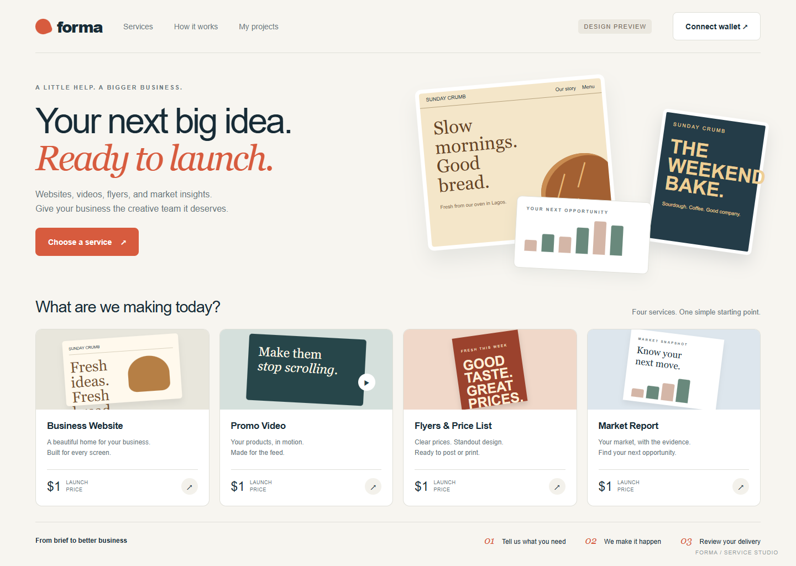
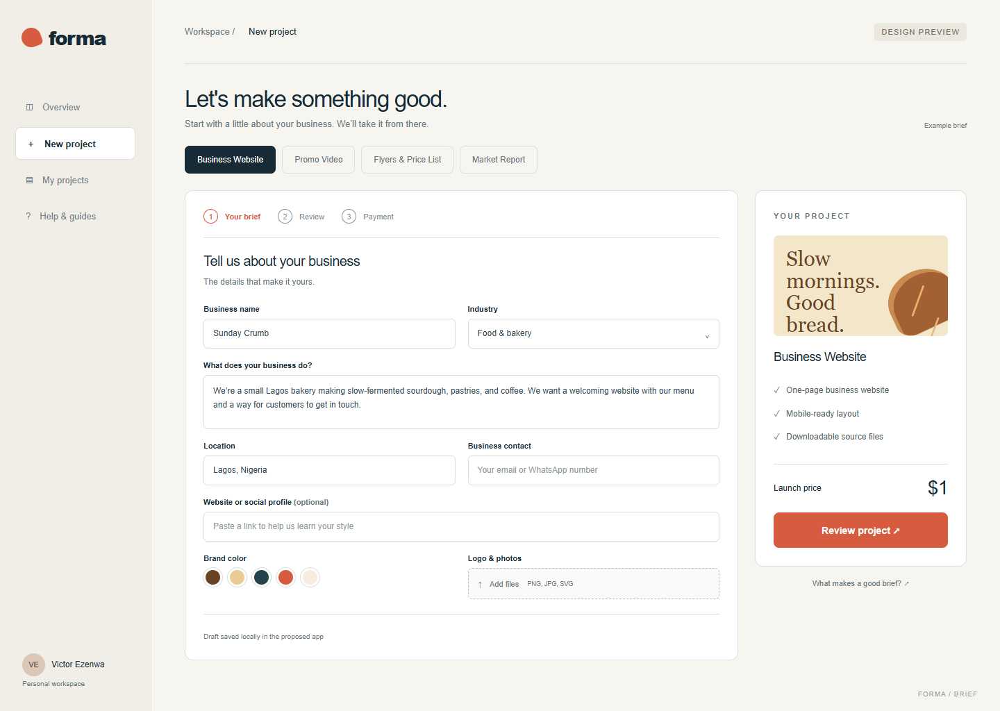
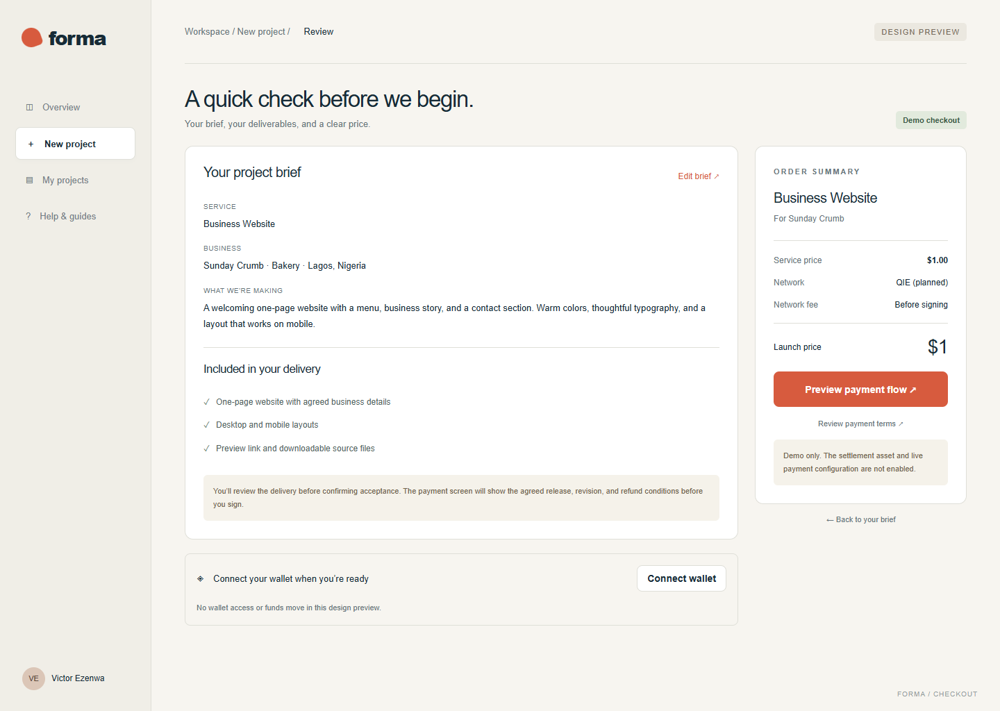
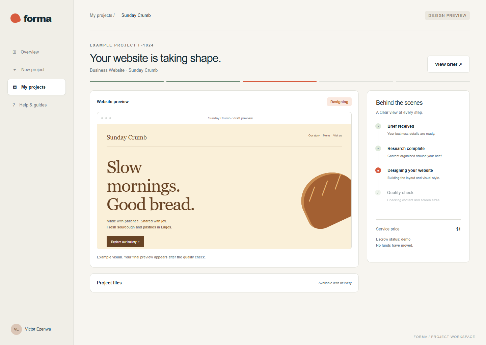
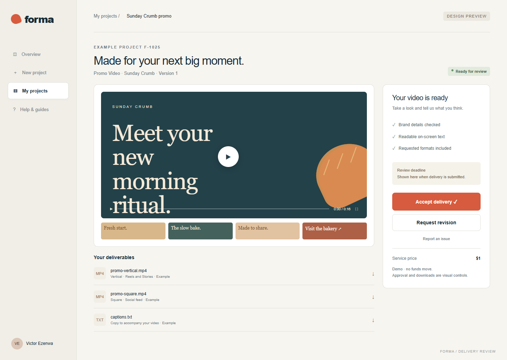
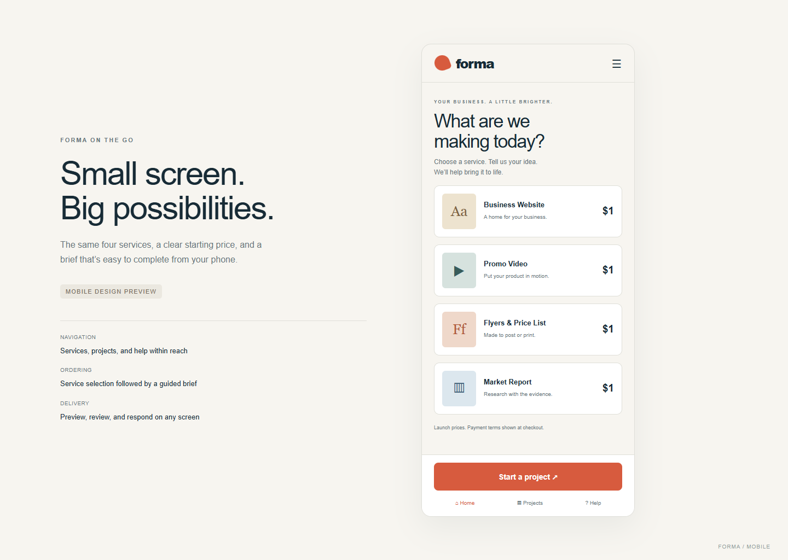

# FORMA — Complete Product, UI/UX, OpenAI and QUSDC Build Specification

Version 1.0 · Prepared for Victor Chukwudi Ezenwa · 24 November 2026

**Status:** implementation specification; application, payment contract and AI backend are not built by this document. The six UI artboards already exist. Forma is a temporary name.

**Authority:** This is the single current build brief. It supersedes the single-service recommendations and unselected payment assets in the earlier research study and companion notes. Where this document says “proposed,” it records an implementation decision, not an already working integration.

## 1. Product and outcome

Build an original AI business studio for small businesses: a customer describes their business, buys one of four bounded creative/research services using QUSDC on QIE, follows progress and receives usable files. Our own backend runs the workflows using OpenAI; it does not hire other AI agents or pay third-party agent wallets.

OpenAI remains an external API provider. We own the application, service logic, prompts, templates, checks and customer relationship—not the underlying model.

**Target customer:** a solo founder or small-business owner who needs a simple launch-ready website, promotional asset or market brief without coordinating multiple tools.

**Product differentiation to implement:** a reusable business brand kit; exact preservation of customer prices/contact information; a machine-checkable delivery manifest; and versioned output hashes linked to QUSDC escrow receipts. These are proposed original features, not a guarantee of hackathon eligibility. A palette change or swapping networks is not meaningful differentiation on its own.

## 2. Competition and deadline

The official page currently states **30 November 2026, 23:59 CET**, equivalent to **23:59 WAT in Nigeria**. Target submission by **20:00 WAT** to leave a buffer. Mainnet deployment is required. Recommended track: **AI + Autonomous Agents**, with Commerce & Real World as an alternative depending on the completed product.

The page requires repository, live demo, deployed contract address and track; inspect the signed-in submission form for anything additional. It prohibits simple clones, copied/forked/recycled projects and AI-generated projects with minimal developer contribution. Build independently, record genuine engineering work and disclose dependencies. Do not copy other branding, source, user statistics or claims. Source: [official competition page](https://hackathon.qie.digital/).

No invented judging weights or mandatory video length. Its testnet quickstart does not override the mainnet submission rule.

## 3. Locked scope

| Service ID | Visible name | Launch price | First-release deliverables |
| --- | --- | --- | --- |
| `business_website` | Business Website | 1 QUSDC | Responsive one-page website preview and source ZIP |
| `promo_video` | Promo Video | 1 QUSDC | One 12–16 second vertical template-rendered MP4 and captions TXT |
| `flyers_price_list` | Flyers & Price List | 1 QUSDC | One promotional PNG, matching PDF and readable price-list PDF |
| `market_report` | Market Report | 1 QUSDC | Cited HTML/PDF market brief and source table CSV |

Display **“1 QUSDC · approximately $1 · launch price”**. Do not guarantee a market dollar price. Network fees are separate and paid in QIE. The visual designs currently say `$1`; replace those labels during implementation, not through currency conversion hidden in the UI.

All four services belong in the final scope. Implement their pipelines incrementally. If one is not ready, disable its checkout and say why; never sell placeholder output as completed work.

### Required

- Original service studio, scoped brief forms, shared brand kit and customer-owned projects.
- Wallet authentication; QIE mainnet/QUSDC checkout; one minimal escrow contract.
- Own OpenAI workflows and trusted artifact renderers for all four services.
- Durable jobs, truthful timeline, private downloads and output validation.
- Customer acceptance, explicit timeout/refund terms and verified explorer receipts.
- Basic owner dashboard: jobs, failures, liabilities and provider usage.
- Clearly separated demo and live modes.

### Optional only after the full flow works

- One bounded revision, email notifications, secondary aspect ratios, voiceover, richer site editing and QIE ID sign-in.

### Explicitly excluded

- External AI-agent hiring/marketplace, x402 sellers, per-agent wallets and autonomous treasury spending.
- Bridge/mint/redemption UI, swaps, fiat onramps, token trading or yield.
- Full AI-generated video scenes, unrestricted website code execution, custom domains and multi-page websites.
- Animated office, soundtrack, accounting suite, recurring subscriptions and ten-agent architecture.

## 4. Design references and visual system

**Primary reference:** [six local artboards](Forma_UI_Design.html). Static mockups, not a functional application. Their example businesses, statuses and files are fixtures. Do not expose them as real customer activity.

| Token | Value | Use |
| --- | --- | --- |
| Canvas | `#F7F5F0` | Warm ivory background |
| Ink | `#172B36` | Navy text, selected states |
| Accent | `#D75B3E` | Coral brand accent; check button contrast |
| Sage | `#E2EADD` | Gentle positive/selected surfaces |
| Blue | `#DCE7ED` | Research/neutral surfaces |
| Surface | `#FFFFFF` | Cards and form controls |
| Border | `#DFDFD8` | Hairline separators |

Editorial serif headlines paired with clean sans-serif controls. Local artboards use Georgia/Arial; production may use Newsreader/Plus Jakarta Sans if bundled or reliably loaded. Avoid external font dependence in generated customer files unless intentional.

Use an 8px spacing rhythm, 8–16px component radii, restrained shadows and original miniature artifact previews. Desktop reference width is 1440px; it is not a required viewport. At 1024px reduce gutters and collapse complex columns; below 768px stack content. Forms and checkout must work at 375px without horizontal scrolling.

Minimum 44px touch targets, real labels, keyboard focus, semantic buttons, alt text, reduced-motion support and AA contrast. State must have text/icon cues, not just color. Ensure loading/status updates are accessible.

### Screen 1 — Service studio



Navigation: logo, Services, How it works, My projects, Connect wallet. Hero: **“Your next big idea. Ready to launch.”** Short supporting copy and choose-service action. Show all four service cards with output preview, scope, launch price and next action. No fabricated traction counters, wallet balances or fulfilled orders.

Connect wallet is optional for browsing; authenticate before storing private projects or paying. Show a small “AI powered by OpenAI” label without implying endorsement.

### Screen 2 — Guided brief



Workspace sidebar: Overview, New project, My projects, Help. Service tabs remain visible. Main column holds labeled questions and a three-step indicator: Brief → Review → Payment. Right panel shows the selected scope, price and expected output. Save drafts server-side for authenticated customers; local drafts are a convenience only.

Shared brand kit: business name, description, industry, location, audience, approved contact details, colors, logo and owned photos. Require explicit selection before reusing a previous kit; never mix customer accounts.

| Service | Extra fields | Initial bounds |
| --- | --- | --- |
| Website | Sections, CTA, approved contact, optional menu/prices, reference style | One page; maximum six sections; no backend/store checkout |
| Promo video | Offer, audience, CTA, approved photos, tone | One 9:16 export; 12–16 seconds; no voiceover initially |
| Flyer/price list | Offer, exact items/prices/currency, expiry if real, contact | One layout family; up to 20 price items; paginate list if needed |
| Report | Geography, question, industry, up to three competitors, optional URLs | Short brief; up to five substantive sections; aim for 3–5 useful sources, disclose shortages |

Do not ask the model to fill in missing prices, testimonials, business credentials or contact details. Ask the customer or omit the field. Preserve drafts after validation errors.

### Screen 3 — Review and checkout



Show an editable brief summary, deliverable list, payment/refund policy, delivery/review deadlines and mode banner. Live summary must show **QIE Mainnet · QUSDC · 1 QUSDC**, connected payer, escrow address and separately estimated QIE gas.

States: wallet disconnected → wrong network → insufficient QUSDC/QIE → approve exact allowance if required → wait for approval → fund escrow → pending → verified funded. A wallet prompt or transaction hash is not proof of funding. Refresh must recover the same order and transaction.

Demo mode says **“Simulated payment — no funds move”**; never label a demo receipt as mainnet. Do not deploy a fixture token and present it as official QUSDC.

### Screen 4 — Workspace and progress



Header: order, service, business and visible state. Main area: latest safe preview and deliverable manifest. Side panel: real saved events—brief validated, queued, generating, rendering, checking, ready. Prefer a stepper to invented completion percentages. Payment status is independent of generation status.

For failures, explain the failed stage, whether work can retry and refund eligibility. Never show an earlier preview as the newly requested version. Display last updated time and reconnect/retry controls.

### Screen 5 — Delivery review



Preview the actual delivered artifact; list filename, format, version and size; include the criteria checklist and download action. Primary action: Accept delivery. Secondary: Report a problem. Revisions are optional, not an unstated included promise.

Show the real acceptance/release deadline, amount and consequences before confirmation. Acceptance in UI means a confirmed on-chain decision, not merely clicking the button. A technical quality checklist is not a guarantee of business results.

The artboard illustrates multiple video exports; the MVP promises only one vertical export. Hide unsupported extras. Keep the example fixture's player/file labels out of live orders.

### Screen 6 — Mobile studio



Stack four service cards with readable labels and QUSDC price. Keep a clear primary action and compact navigation. Adapt all subsequent screens too: single-column forms, review summary before payment, wrapped addresses and accessible download/player controls. Do not scale down a fixed desktop canvas.

## 5. Application structure

Suggested routes:

```text
/                          Service studio
/new?service=...           Brief
/projects/:id/review       Scope and quote
/projects/:id/checkout     Wallet and escrow funding
/projects/:id              Progress and delivery review
/projects                 Customer project history
/help                     Scope, payment and refund explanations
/admin                    Restricted operations dashboard
```

Use TypeScript, Next.js/React, PostgreSQL, private object storage, a durable Node worker and viem/wagmi. Use Foundry for contract tests. These are default choices; reuse an existing compatible repository stack if that saves time. Do not install multiple competing backends or frameworks without need.

Run web/API and a separate long-lived worker. Use a Postgres-backed job queue with leases, or a proven queue already available in the project. Do not run long generation inside a short web request or rely on an in-memory queue.

```text
Browser -> authenticated API -> Postgres orders/quotes/jobs
                                  |             |
                               reconciler    durable worker
                                  |             |-- OpenAI
                            QIE escrow          |-- trusted renderers
                                                |-- quality checks
                                                '-- private artifacts
```

## 6. OpenAI and own service execution

All OpenAI calls run server-side using our API account. Customer QUSDC does not directly pay OpenAI; we separately fund the API bill. Do not claim on-chain AI-provider payments.

Logical modules: brief validation, service router, OpenAI client, four service builders, renderer, quality checker, artifact storage and payment reconciler. They can be normal functions rather than autonomous agents. No model receives signing keys or arbitrary payment authority.

Use the Responses API for suitable text/structured-data and web-grounded workflows. Select model IDs from the available account at implementation time, configure them through environment variables and record model/prompt versions on each job. Do not hardcode speculative model IDs or prices from this document.

### Website pipeline

1. Validate business facts, required sections and assets.
2. Generate schema-constrained copy and layout data using OpenAI.
3. Render using our own responsive templates and sanitized content.
4. Validate links/contact/prices; check mobile screenshot and overflow.
5. Produce isolated preview, source ZIP and manifest.

No unrestricted code execution. Preview on a separate origin with restrictive policy. Avoid a live contact form unless a real backend exists; use approved mail/phone links. Never invent reviews or certifications.

### Promo-video pipeline

1. OpenAI produces a short script and timed scene plan.
2. Select customer-approved assets or a clearly disclosed typographic template.
3. Render 12–16 second 1080×1920 H.264 MP4 using a trusted compositor/FFmpeg pipeline.
4. Generate captions TXT; verify duration, dimensions, playback and safe text bounds.
5. Save MP4, poster frame and manifest.

A storyboard is not the purchased video. No fake play control on a still image in production. Voiceover/music and generative-video APIs are out of scope initially; use only licensed assets if later added.

### Flyer and price-list pipeline

1. Validate exact item names, prices, currency and contact details.
2. OpenAI drafts promotional copy and structured layout choices.
3. Our templates render a 1080×1350 PNG, matching flyer PDF and A4 price-list PDF.
4. Compare output text/numbers against source inputs; check clipping, pagination and small-screen readability.
5. Deliver files and manifest. Never silently alter prices or add discounts.

### Market-report pipeline

1. Validate geography/questions; constrain research scope.
2. Use supported OpenAI web search; preserve URLs, titles and retrieval timestamps.
3. Draft concise findings with claim-source associations, recommendations and limitations.
4. Separate sourced facts from inference; reject fabricated URLs or unsupported statistics.
5. Render HTML/PDF and source CSV. Disclose limited evidence rather than inventing sources.

Source pages and uploaded documents are untrusted data, not instructions to the worker. Disable arbitrary URL retrieval or restrict it to public HTTP(S), checking resolved destinations to prevent private-network access.

### Budgets and durability

At a 1 QUSDC launch price, unlimited generations are not viable. Configure per-job limits for text tokens, searches, images, render duration, file sizes and retries. Optional image generation is off by default until measured. Record provider usage and estimated versus known costs; do not invent accounting precision.

Persist each stage: validate → generate/research → render → check → deliver. Save provider request IDs and stage outputs. Prevent duplicate execution with leases and unique job keys. Use bounded backoff for transient errors; reconcile ambiguous paid requests where possible before rerunning. A failed stage must not silently pass quality review.

## 7. Payment configuration — QUSDC on QIE

| Setting | Value |
| --- | --- |
| Network | QIE Mainnet |
| EVM chain ID | `1990` (`0x7c6`) |
| Public RPC | `https://rpc1mainnet.qie.digital` |
| Explorer | `https://mainnet.qie.digital` |
| Gas currency | QIE, 18 decimals |
| Settlement token | QUSDC, ERC-20, 6 decimals |
| QUSDC address | `0x3F43DA82eC9A4f5285F10FaF1F26EcA7319E5DA5` |
| One service price | `1000000` QUSDC base units |

Read-only checks on 24 November confirmed chain ID 1990 and the address returning name/symbol QUSDC and six decimals. Explorer API exposed source named QUSDC with role-gated mint/burn. This is not an audit or proof of reserves.

QUSDC documentation describes bridging Ethereum USDC into WUSDC, locking that collateral to mint QUSDC, and reversing the process to exit. No bridge/mint UI is needed in this MVP: customers must already hold QUSDC and enough QIE for fees. Explain that requirement in Help.

**Short pre-live gate:** verify address/decimals again, test exact token transfer behavior, verify the app escrow deployment and complete an explicitly authorized small-value fund/accept/refund check. Reserve-vault backing, redemption and admin/bridge risk remain unverified; do not advertise guaranteed safety or cash redemption. This is a tracked limitation, not a new feature workstream.

Store base-unit amounts as integers/decimal strings, never floating-point. Use `parseUnits("1", 6)`. Do not confuse QUSDC with USDC, WUSDC or test tokens; whitelist by chain ID plus full address, not symbol.

## 8. Minimal escrow and commercial terms

Deploy one independently written `ServiceEscrow` using established safe ERC-20 transfer and reentrancy protection libraries. Make the QUSDC asset and settlement treasury immutable for this release. No swap, upgrade proxy, per-agent treasury or yield component.

Proposed terms, to finalize and disclose before live orders: fund within 30 minutes of quote; deliver within 24 hours of confirmed funding; review within 48 hours of submitted delivery. These are payment deadlines, not a promise that generation takes hours. Display exact UTC timestamps with local equivalents.

Suggested actions (names may vary):

| Action | Authority | Effect |
| --- | --- | --- |
| `createJob` | Restricted operator | Bind unique ID, customer, amount, terms hash, funding expiry and deadlines |
| `fundJob` | Recorded customer | Transfer exactly the quoted QUSDC amount into escrow |
| `submitDelivery` | Restricted operator | Record immutable delivery manifest hash, open review window |
| `acceptDelivery` | Recorded customer | Release the fixed amount to the fixed treasury once |
| `refundJob` | Restricted operator, eligible funded/delivered state | Refund only the recorded customer once |
| `claimLateRefund` | Customer after missed delivery deadline | Refund undelivered funded job |
| `claimReviewRelease` | Any permitted caller after review window | Release delivered job to fixed treasury; never caller |

Display automatic-release terms before funding. Time alone does not execute a transaction; a reconciler submits eligible actions. An operator refund remains possible for a genuine failure before settlement. Initial disputes use a support flow, not an invented trustless arbitration guarantee. A customer cannot receive output then unilaterally refund merely by pressing Reject. No one can refund or release a closed job again.

Use an explicit transition table in contract tests. Delivery must precede release; missed delivery cannot become a review timeout. Customer escrow is a liability, not operating cash. Restrict any emergency recovery so it cannot withdraw protected QUSDC. No model output controls recipients or contract administration.

Prefer exact allowance for a new payment. Verify approval receipt, funding receipt, contract address, event, customer, job ID, asset and amount. Receipt status alone is insufficient. Reconcile uncertain outcomes before asking for another transaction. Record block number/hash and handle RPC failures honestly.

Optional revisions are excluded from the first contract. If added later, define how the review deadline changes and test both contract and UI; do not promise revisions only in frontend copy.

## 9. Authentication, data and artifacts

Use nonce-based wallet sign-in with domain, chain, expiry and single-use nonce verification. Merely connecting a wallet is not authentication. Bind session ownership to orders and enforce it on every query/download. Admin role is server-authorized, never a client flag.

| Entity | Essential data |
| --- | --- |
| Customer | ID, wallet binding, session/auth metadata |
| Brand kit | Customer ID, approved facts, colors, private assets, version |
| Service | ID, schema/version, enabled flag, deliverable policy |
| Quote | Customer, service/version, brief hash, amount/asset/chain, expiry, terms version |
| Order | Customer, quote, chain job ID, work state, payment state, deadlines |
| Job/step | Lease, attempt, stage, input/output refs, provider request ID, usage/error |
| Artifact | Order, version, storage key, MIME, size, checksum, access policy |
| Delivery manifest | Required files, checks/results, schema version, manifest hash |
| Chain event/transaction | Chain, contract, tx hash, log index, action, job, confirmation status |
| Support issue | Customer/order, description, resolution, refund reference if any |

Unique constraints: one order per quote; unique chain job ID; unique `(chainId, txHash, logIndex)` events; one active execution lease; settlement processed once. Use transactions/state-version checks for concurrent updates.

Private storage only. Short-lived signed download URLs after ownership checks. File URLs must not be guessable public authorization. On-chain data contains IDs/hashes, not briefs, contacts or deliverables. A hash is a version commitment, not proof of quality.

Canonical manifest JSON should record service, order ID, version, artifact checksums, required checks and result. Define deterministic serialization before hashing. Do not include secrets or customer contact data in publicly published manifests.

## 10. API and state model

| Endpoint | Purpose |
| --- | --- |
| `GET /api/services` | Enabled services and scope |
| `POST /api/auth/nonce`, `POST /api/auth/verify` | Wallet authentication |
| `GET/PUT /api/brand-kit` | Customer-owned reusable details |
| `POST /api/uploads` | Validated customer asset upload |
| `POST /api/quotes` | Validate brief, freeze price/terms |
| `POST /api/orders` | Idempotent order creation |
| `GET /api/orders/:id` | Owned state and deadlines |
| `POST /api/orders/:id/payment-sync` | Server-verified reconciliation, not trust in client hash |
| `GET /api/orders/:id/events` | Event stream or replayable polling |
| `GET /api/orders/:id/artifacts` | Authorized previews/downloads |
| `POST /api/orders/:id/issues` | Customer problem report |
| `POST /api/orders/:id/decision-sync` | Reconcile on-chain acceptance |
| `GET /api/admin/jobs` | Restricted failures, costs and liabilities |
| `GET /api/health` | Minimal health and mode |

Work states: `draft`, `quoted`, `awaiting_funding`, `queued`, `running`, `checking`, `delivered`, `failed`, `closed`. Payment states: `unfunded`, `pending`, `funded`, `release_pending`, `released`, `refund_pending`, `refunded`, `unknown`. An RPC timeout means unknown, not failed or paid again. Enforce allowed combinations in application logic.

Worker starts only after verified funding in live mode. Demo jobs take a separate explicitly simulated route. Replay saved events on refresh/reconnect. Polling is acceptable for the deadline if streaming costs extra engineering effort.

## 11. Configuration and operating boundaries

```dotenv
APP_MODE=demo
APP_URL=http://localhost:3000
DATABASE_URL=
SESSION_SECRET=
OPENAI_API_KEY=
OPENAI_TEXT_MODEL=
OPENAI_RESEARCH_MODEL=
OPENAI_IMAGE_MODEL=
QIE_CHAIN_ID=1990
QIE_RPC_URL=https://rpc1mainnet.qie.digital
QIE_EXPLORER_URL=https://mainnet.qie.digital
QUSDC_ADDRESS=0x3F43DA82eC9A4f5285F10FaF1F26EcA7319E5DA5
QUSDC_DECIMALS=6
SERVICE_PRICE_BASE_UNITS=1000000
ESCROW_ADDRESS=
TREASURY_ADDRESS=
OPERATOR_SIGNER_REFERENCE=
STORAGE_BUCKET_PRIVATE=
STORAGE_ACCESS_KEY=
STORAGE_SECRET_KEY=
PREVIEW_ORIGIN=
MAX_JOB_COST_USD=
MAX_PROVIDER_RETRIES=2
```

Blank values are required setup, not valid defaults. Use server-only secrets and separate production/demo storage and credentials. Client-safe chain/address settings may be exposed deliberately; secrets never may. Validate live configuration at startup and fail closed if missing/mismatched. Keep signing keys in a secret manager or narrow signer; never in generated source or prompts.

No mainnet signing, spending, paid API calls or deployment happens simply because this document exists. Perform those later under the user's explicit authorization and applicable wallet controls.

Rate-limit auth, quote, upload and job creation. Restrict upload MIME and size, inspect actual content, sanitize SVG or disable SVG uploads initially. Prevent ZIP path traversal and shell injection; pass renderer arguments safely. Do not execute customer/model-supplied shell commands.

## 12. Build sequence: 24–30 November, WAT

| Date | Main outcome | Exit check |
| --- | --- | --- |
| 24 Nov | Scaffold app, implement design shell, all four brief schemas, brand kit and payment adapter skeleton | Mobile forms save valid drafts; live settings explicit |
| 25 Nov | Escrow, wallet auth, quotes and local payment tests | Funding/accept/refund/timeout/access tests pass with mock ERC-20 |
| 26 Nov | Own website and flyer pipelines; durable worker/storage | Real downloaded outputs pass checks and survive worker restart |
| 27 Nov | Report and template-video pipelines | Cited report and playable MP4 generated from new briefs |
| 28 Nov | Full checkout/reconciliation, isolated previews, mainnet deployment after authorization | Verified deployment and authorized small-value settlement/refund receipts |
| 29 Nov | Real-user walkthrough, error/mobile fixes, original contribution notes and demo | Reviewer completes real flow; limitations recorded |
| 30 Nov | Final deployment smoke tests and submission by 20:00 WAT target | Repo/demo/contract/track links all work before 23:59 WAT |

Keep one complete real workflow working throughout. If behind, cut optional effects, voiceover, extra exports and revisions first—not ownership checks, payment verification or honest service status. An incomplete mainnet integration must be disclosed; a demo-only product does not satisfy the published mainnet requirement.

## 13. Acceptance checklist

### UI and customer workflow

- [ ] Four services visible with correct scope and 1 QUSDC launch price.
- [ ] Forms, checkout and delivery work at 375px and desktop; keyboard usable.
- [ ] Price/currency/contact data preserved exactly; no invented business claims.
- [ ] Drafts survive refresh and errors; another customer cannot access them.
- [ ] Progress derives from real stages; fixture previews clearly labeled.
- [ ] Every promised download exists, opens and matches its MIME/version.

### Generation

- [ ] New website brief produces usable responsive files, not a static fixture.
- [ ] New promo brief produces a playable MP4, not only script/poster.
- [ ] Flyer/list export preserves all prices and paginates safely.
- [ ] Report has working supporting sources and labels inference/uncertainty.
- [ ] Model schema failure, provider timeout, renderer failure and budget exhaustion have honest outcomes.
- [ ] Restart/retry does not duplicate billing/work blindly or lose completed stages.

### Contract and payment

- [ ] Wrong chain/token/customer/amount/job/contract cannot mark order funded.
- [ ] No worker starts for an unverified live payment.
- [ ] Duplicate events cannot double-generate, release or refund.
- [ ] Only customer accepts; only operator submits; recipients fixed.
- [ ] Funding expiry, late refund and review release boundaries tested.
- [ ] Release/refund unknown states reconcile before another attempt.
- [ ] Approval rejection and insufficient QIE/QUSDC have clear recovery.
- [ ] Unit/integration tests use mocks or test environments and never spend mainnet funds.
- [ ] Mainnet checks separately authorized and recorded; source verification not described as an audit.

### Security and delivery

- [ ] No API/signing/storage secrets in client bundle, logs or artifacts.
- [ ] Private storage and preview-origin isolation work.
- [ ] Prompt injection, untrusted URLs/uploads and renderer inputs are constrained.
- [ ] Admin routes enforced server-side; no public refund endpoint without authority.
- [ ] Demo mode has no live signer and cannot generate fake mainnet receipts.

## 14. Demo and submission

Demo story: a small-business owner selects a service, reuses an approved brand kit, confirms a 1 QUSDC quote, funds escrow, sees generation events, inspects real output and accepts delivery with an explorer receipt. Show an additional service output briefly to establish the breadth. Keep setup and architecture explanation short. Label any accelerated/prerecorded/fixture segment.

Repository should include: setup instructions, environment example without secrets, schema/migrations, worker command, contract tests/deployment info, supported services, payment terms, demo/live separation, known limitations and attribution. Record original features and real developer contributions. Use only actual user/transaction metrics; no fabricated traction.

Submission fields: final name, problem/customer, original contribution, track, public repository, working live URL, QIE mainnet escrow address, how to try the product, known limitations and any additional signed-in form fields. A demo video is useful supporting material; verify the organizer's exact requirements.

## 15. Copy-ready implementation handoff

> Build Forma independently from this specification and its six supplied artboards. Use all four selected services and the original ivory/navy/coral visual direction. Implement our own OpenAI-backed workflows, trusted rendering, durable jobs, reusable customer brand kits and checked delivery manifests. Customer settlement is QUSDC on QIE mainnet (chain 1990; address and six decimals above); QIE pays gas. Build one minimal escrow with explicit customer acceptance, operator refunds, late-delivery refunds and disclosed review-timeout release. Do not hire external AI agents, copy external code, run arbitrary generated code or claim fake activity. Keep all secrets server-side and demo/live paths isolated. Implement and test local payment flows before requesting any live deployment or spending authorization. Finish each service's real downloadable artifact, ownership checks and failure paths. Use the deadline plan; drop optional features first. Do not call the app complete until the acceptance checklist passes and remaining limitations are stated.

## 16. Sources and evidence boundaries

- [QIE hackathon](https://hackathon.qie.digital/): deadline, mainnet requirement, tracks, submission and originality rules.
- [QIE developers](https://www.qie.digital/developers): network configuration reference.
- [QUSDC documentation](https://docs.stable.qie.digital/): stated backing model.
- [Minting and redemption](https://docs.stable.qie.digital/how-qusdc-works): bridged WUSDC collateral and exit flow.
- [QUSDC contract](https://mainnet.qie.digital/address/0x3F43DA82eC9A4f5285F10FaF1F26EcA7319E5DA5?tab=contract) and [explorer API](https://mainnet.qie.digital/api/v2/smart-contracts/0x3F43DA82eC9A4f5285F10FaF1F26EcA7319E5DA5): read-only contract metadata/source check; not a security audit.
- [OpenAI Responses API](https://developers.openai.com/api/reference/responses/overview), [web search](https://developers.openai.com/api/docs/guides/tools-web-search), [image generation](https://developers.openai.com/api/docs/guides/tools-image-generation): implementation references. Check current account access/models/prices before integration.

Local design assets: `Forma_UI_Design.html` and `Forma_Screen_1.png` through `Forma_Screen_6.png` in the same directory. Keep them next to this Markdown when sharing so previews remain available. The locally authored artboards are the UI reference; the separate Stitch concept is optional exploration and does not override this document.

Documented claims about reserves, redemption and decentralization have not been independently audited. Actual API costs, production throughput, service delivery times and escrow security remain implementation/test outcomes—not established results.
